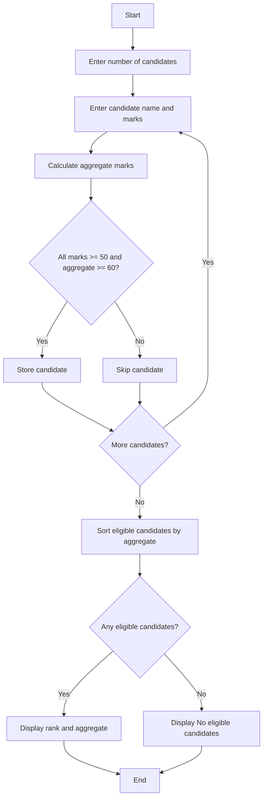

## 1. Problem Statement

Develop a **University Admission Decision Engine** to check candidate eligibility based on Mathematics, Physics, Chemistry marks, and aggregate marks. Display eligible candidates in rank order based on their aggregate marks.

## 2. Algorithm

1. Start.
2. Enter the number of candidates.
3. Enter each candidate's name and marks in Mathematics, Physics, and Chemistry.
4. Calculate the aggregate marks.
5. Check whether all subject marks are at least 50 and aggregate is at least 60.
6. Store eligible candidates.
7. Sort eligible candidates in descending order of aggregate marks.
8. Display the candidates with their ranks.
9. If no candidate is eligible, display "No eligible candidates."
10. Stop.

## 3. Flowchart

## 4. Sample Input

```text
Enter number of candidates: 3

Candidate 1
Enter name: Ravi
Enter Mathematics marks: 80
Enter Physics marks: 75
Enter Chemistry marks: 85

Candidate 2
Enter name: Sita
Enter Mathematics marks: 65
Enter Physics marks: 70
Enter Chemistry marks: 60

Candidate 3
Enter name: Gita
Enter Mathematics marks: 45
Enter Physics marks: 80
Enter Chemistry marks: 75
```

## 5. Sample Output

```text
--- Eligible Candidates ---
1 Ravi 80.0
2 Sita 65.0

Admission ranking generated successfully.
```

This version avoids **`lambda`** completely, so it's easier for a 1st-year viva.
