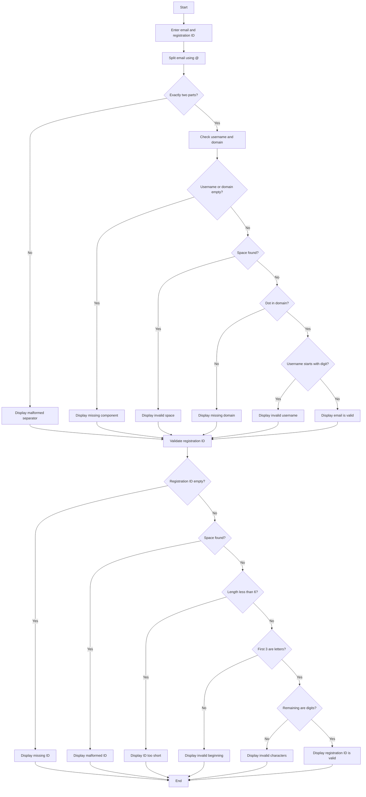

## 1. Problem Statement

Develop a **Student Email and Identifier Validation System** to validate a student's email address and registration ID. The program should identify missing components, spaces, incorrect formats, and invalid character groups.

## 2. Algorithm

1. Start.
2. Enter the student email and registration ID.
3. Split the email using `@`.
4. Check whether the email has exactly one `@`.
5. Check username, domain, spaces, and domain extension.
6. Display the email validation result.
7. Check whether the registration ID is empty.
8. Check spaces and minimum length.
9. Check whether the first three characters are letters.
10. Check whether the remaining characters are digits.
11. Display the registration ID validation result.
12. Stop.

## 3. Flowchart

## 4. Sample Input

```text
Enter student email: student@gmail.com
Enter registration ID: ABC123
```

## 5. Sample Output

```text
--- Email Validation ---
Email is valid.

--- Registration ID Validation ---
Registration ID is valid.
```
