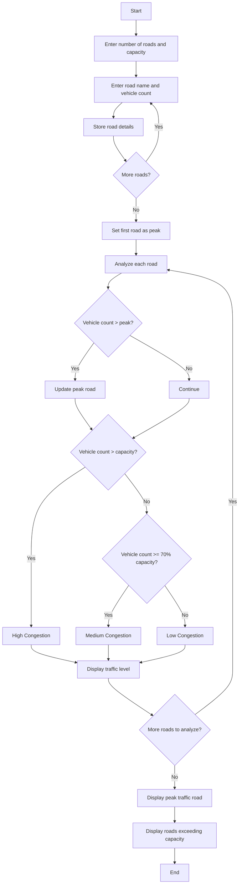

## 1. Problem Statement

Develop a **Traffic Flow and Congestion Analysis System** to analyze the vehicle count on different roads. The program should classify traffic as low, medium, or high congestion, identify the road with peak traffic, and display roads that exceed their capacity.

## 2. Algorithm

1. Start.
2. Enter the number of roads and road capacity.
3. Enter the road name and vehicle count for each road.
4. Store the road details.
5. Find the road with the highest vehicle count.
6. Compare vehicle count with road capacity.
7. Classify traffic as high, medium, or low congestion.
8. Display the traffic analysis for each road.
9. Display the peak traffic road and vehicle count.
10. Display roads exceeding capacity.
11. Stop.

## 3. Flowchart


## 4. Sample Input

```text
Enter number of roads: 3
Enter road capacity: 100

Road 1
Enter road name: Main Road
Enter vehicle count: 80

Road 2
Enter road name: Market Road
Enter vehicle count: 120

Road 3
Enter road name: College Road
Enter vehicle count: 50
```

## 5. Sample Output

```text
--- Traffic Analysis ---
Main Road : 80 - Medium Congestion
Market Road : 120 - High - Exceeds Capacity
College Road : 50 - Low Congestion

Peak Traffic Road: Market Road
Peak Vehicle Count: 120

Roads Exceeding Capacity:
Market Road
```
