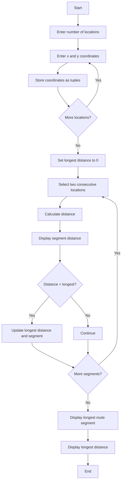

## 1. Problem Statement

Develop a **Tuple-Based Route Distance Analysis System** to store the coordinates of different locations using tuples. Calculate the distance between consecutive locations and identify the longest route segment.

## 2. Algorithm

1. Start.
2. Enter the number of locations.
3. Enter the x and y coordinates of each location.
4. Store each location as a tuple.
5. Set the longest distance to zero.
6. Calculate the distance between consecutive locations.
7. Display each segment distance.
8. Compare each distance with the longest distance.
9. Update the longest segment if required.
10. Display the longest route segment and distance.
11. Stop.

## 3. Flowchart



## 4. Sample Input

```text id="e3wq9c"
Enter number of locations: 3

Location 1
Enter x coordinate: 0
Enter y coordinate: 0

Location 2
Enter x coordinate: 3
Enter y coordinate: 4

Location 3
Enter x coordinate: 9
Enter y coordinate: 4
```

## 5. Sample Output

```text id="nq7w4m"
--- Route Distances ---
Segment 1 Distance: 5.0
Segment 2 Distance: 6.0

Longest Route Segment: 2
Longest Distance: 6.0
Route analysis completed.
```
