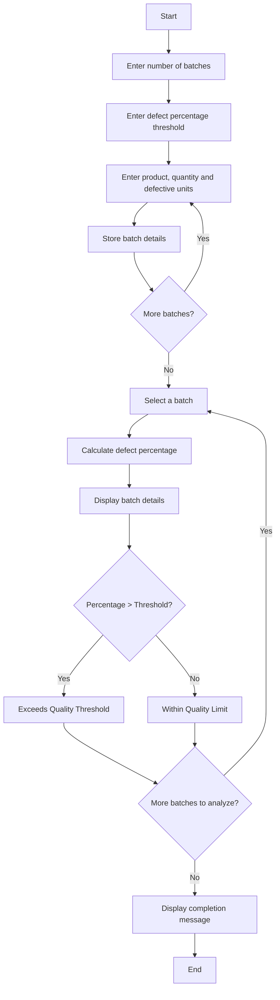

## 1. Problem Statement

Develop a **Manufacturing Quality Control System** to calculate the defect percentage of different production batches and compare it with a given quality threshold. Display whether each batch exceeds the quality limit or is within the acceptable limit.

## 2. Algorithm

1. Start.
2. Enter the number of batches.
3. Enter the defect percentage threshold.
4. Enter product name, production quantity, and defective units for each batch.
5. Store the batch details as tuples.
6. Calculate the defect percentage for each batch.
7. Compare the defect percentage with the threshold.
8. Display the quality status of each batch.
9. Display the completion message.
10. Stop.

## 3. Flowchart



## 4. Sample Input

```text id="q9x3kw"
Enter number of batches: 2
Enter defect percentage threshold: 5

Batch 1
Enter product name: Product A
Enter production quantity: 1000
Enter defective units: 30

Batch 2
Enter product name: Product B
Enter production quantity: 500
Enter defective units: 40
```

## 5. Sample Output

```text id="m4z8pt"
--- Quality Control Report ---

Product: Product A
Production: 1000
Defective: 30
Defect Percentage: 3.0 %
Status: Within Quality Limit

Product: Product B
Production: 500
Defective: 40
Defect Percentage: 8.0 %
Status: Exceeds Quality Threshold

Quality analysis completed.
```
