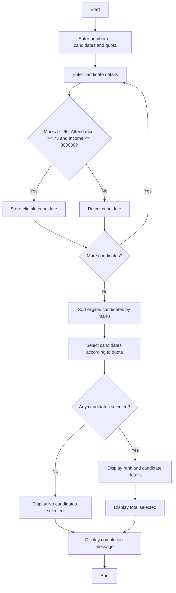

## 1. Problem Statement

Develop a **Scholarship Shortlisting System** to select students based on academic marks, attendance percentage, and family income. Eligible students should be ranked according to their academic marks, and students should be selected according to the scholarship quota.

## 2. Algorithm

1. Start.
2. Enter the number of candidates and scholarship quota.
3. Enter each candidate's name, academic marks, attendance, and family income.
4. Check whether marks are at least 60, attendance is at least 75%, and income is at most ₹3,00,000.
5. Store eligible candidates.
6. Sort eligible candidates according to marks in descending order.
7. Select candidates according to the scholarship quota.
8. Display the selected candidates and their ranks.
9. If no candidates are selected, display the appropriate message.
10. Stop.

## 3. Flowchart

## 4. Sample Input

```text id="n8f2kc"
Enter number of candidates: 3
Enter scholarship quota: 2

Candidate 1
Enter name: Ravi
Enter academic marks: 85
Enter attendance percentage: 90
Enter family income: 200000

Candidate 2
Enter name: Sita
Enter academic marks: 78
Enter attendance percentage: 80
Enter family income: 250000

Candidate 3
Enter name: Gita
Enter academic marks: 65
Enter attendance percentage: 70
Enter family income: 150000
```

## 5. Sample Output

```text id="k3w9pd"
--- Scholarship Shortlist ---
Rank 1 Ravi 85.0
Rank 2 Sita 78.0
Total Selected: 2
Scholarship selection completed.
```
