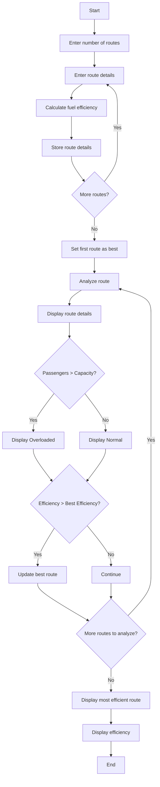

## 1. Problem Statement

Develop a **Bus Route Performance Analysis System** to analyze passenger capacity, journey time, fuel usage, and fuel efficiency of different bus routes. The program should identify overloaded routes and determine the most fuel-efficient route.

## 2. Algorithm

1. Start.
2. Enter the number of bus routes.
3. Enter route name, passengers, bus capacity, journey time, and fuel used.
4. Calculate fuel efficiency as passengers divided by fuel used.
5. Store the route details.
6. Check whether the passengers exceed the bus capacity.
7. Display the performance details of each route.
8. Compare the efficiency of each route.
9. Identify the most efficient route.
10. Display the most efficient route and its efficiency.
11. Stop.

## 3. Flowchart

## 4. Sample Input

```text id="u2c9kp"
Enter number of routes: 2

Route 1
Enter route name: Route A
Enter passengers: 40
Enter bus capacity: 50
Enter journey time: 2
Enter fuel used: 10

Route 2
Enter route name: Route B
Enter passengers: 60
Enter bus capacity: 50
Enter journey time: 2.5
Enter fuel used: 12
```

## 5. Sample Output

```text id="w7n4sd"
--- Bus Route Analysis ---

Route: Route A
Passengers: 40
Journey Time: 2.0
Fuel Used: 10.0
Efficiency: 4.0
Status: Normal

Route: Route B
Passengers: 60
Journey Time: 2.5
Fuel Used: 12.0
Efficiency: 5.0
Status: Overloaded

Most Efficient Route: Route B
Efficiency: 5.0
```
