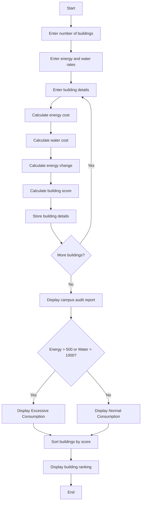

## 1. Problem Statement

Develop an **Integrated Campus Energy and Water Audit System** to calculate energy cost, water cost, and energy consumption changes for different campus buildings. The program should identify buildings with excessive consumption and rank them based on their combined energy and water consumption.

## 2. Algorithm

1. Start.
2. Enter the number of buildings.
3. Enter energy cost per unit and water cost per unit.
4. Enter building name, energy consumption, water consumption, and previous energy consumption.
5. Calculate energy cost and water cost.
6. Calculate the percentage change in energy consumption.
7. Calculate the building score.
8. Display the audit report.
9. Check whether energy or water consumption is excessive.
10. Sort buildings according to their score in descending order.
11. Display the building ranking.
12. Stop.

## 3. Flowchart

## 4. Sample Input

```text id="f4p7zs"
Enter number of buildings: 2
Enter energy cost per unit: 8
Enter water cost per unit: 2

Building 1
Enter building name: Block A
Enter energy consumption: 600
Enter water consumption: 900
Enter previous energy: 500

Building 2
Enter building name: Block B
Enter energy consumption: 400
Enter water consumption: 1200
Enter previous energy: 450
```

## 5. Sample Output

```text id="k6v2nx"
--- Campus Audit Report ---

Building: Block A
Energy Cost: 4800.0
Water Cost: 1800.0
Energy Change: 20.0 %
Status: Excessive Consumption

Building: Block B
Energy Cost: 3200.0
Water Cost: 2400.0
Energy Change: -11.11 %
Status: Excessive Consumption

--- Building Ranking ---
1 Block A Score: 1500.0
2 Block B Score: 1600.0
```

